<a href="https://gustavof442.github.io">
  
</a>

  
  <a href="https://www.linkedin.com/in/gv-fraga/">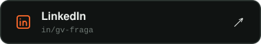</a>
  

 

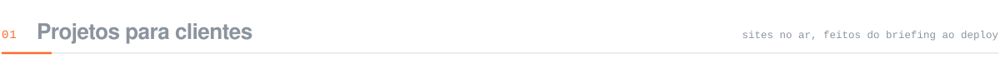

  <a href="https://libertyimoveissc.com.br/"></a>
  <a href="https://nutrienricobecker.com.br/"></a>
  <a href="https://gustavof442.github.io/#projetos"></a>
  <a href="https://gustavof442.github.io/#projetos"></a>

 

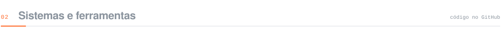

  <a href="https://gustavof442.github.io/#ferramentas"></a>
  <a href="https://github.com/GustavoF442/LacosWebManagement">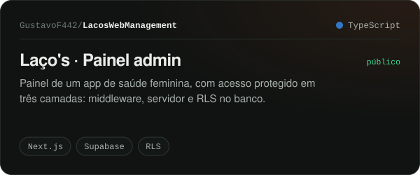</a>
  <a href="https://github.com/GustavoF442/ConversorDeImagens"></a>
  <a href="https://github.com/GustavoF442/PP1-SBaron"></a>

 

<a href="https://gustavof442.github.io/#formacao">
  
</a>

  

<a href="https://gustavof442.github.io">
  
</a>
