  
  
  

Analista de Suporte de Sistemas na **Tutor Software (SJSYS)** e graduando em Sistemas de Informação pela **UNIFEBE**.
No dia a dia, resolvo chamados, mantenho estações de trabalho e faço a ponte entre o usuário e o sistema.
Fora dele, desenvolvo sites e sistemas web para clientes com Next.js, TypeScript e Supabase.

### `01` · Em produção

| Projeto | O que é | Stack |
| --- | --- | --- |
| **[Liberty Imóveis SC](https://libertyimoveissc.com.br/)** · case de sucesso | Plataforma imobiliária com painel admin, blog semanal gerado por IA e indicadores do Banco Central | `Next.js` `Supabase` `OpenAI` |
| **Enrico Becker** · nutricionista | Site profissional com agendamento pelo WhatsApp | `Web` |
| **Ateliê Solange Vargas** | Loja de crochê com carrinho, pedidos via WhatsApp, painel com MFA e Turnstile | `React` `Supabase` `Cloudflare` |
| **JB Máquinas** | Catálogo técnico com 89 modelos importados e orçamento com anti-spam | `Next.js 16` `TypeScript` |
| **[Laço's · Painel](https://github.com/GustavoF442/LacosWebManagement)** | Painel admin de app de saúde feminina, protegido em 3 camadas (middleware, server, RLS) | `Next.js` `Supabase` |
| **[Conversor de Imagens](https://github.com/GustavoF442/ConversorDeImagens)** | Fotos de calçados → desenho técnico 1-bit para impressoras térmicas Argox | `TypeScript` `Canvas` |

### `02` · Roadmap 2026

### `03` · Stack

### `04` · Atividade

  
  

São João Batista, SC · Brasil
